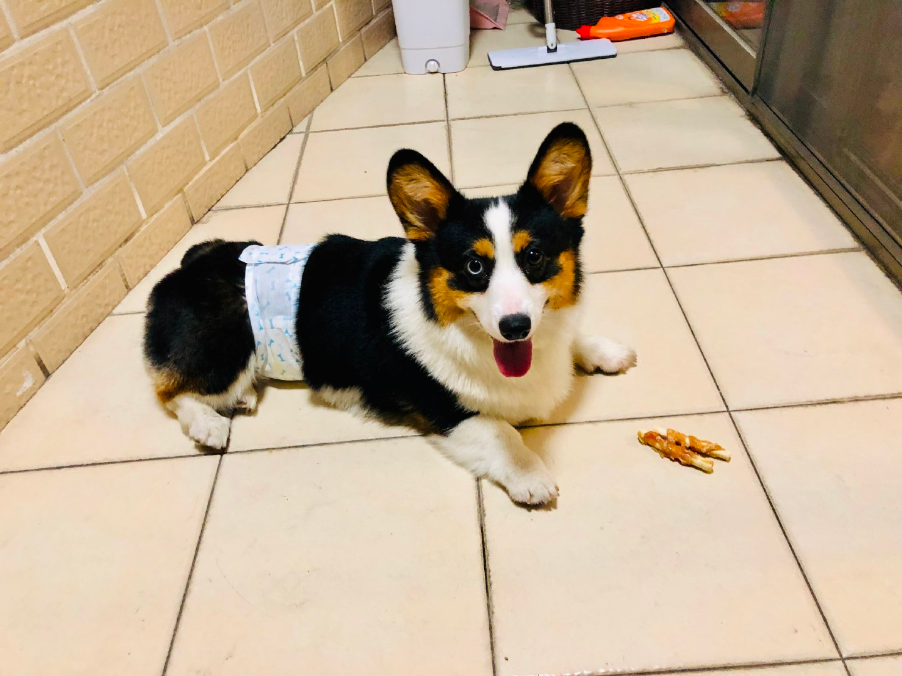

## 👋 Introduction

<!--
**erkang/erkang** is a ✨ _special_ ✨ repository because its `README.md` (this file) appears on your GitHub profile.
-->
### Hi there 👋

I'm `erkang`. 你也可以在我的 [blog](https://qekang.com) 找到我。

如果要用一个词概括我现在在做的事情，那就是 `AI Engineering`。

到 2026 年，我已经把自己的工作重心全面切到 `AI Engineering` 与 `AI Systems` 的深入研究和真实落地上。对我来说，AI 不只是一个提效工具，更是一套正在重构软件生产方式的新基础设施。我长期关注的重点，不是模型会不会回答问题，而是如何把顶级模型能力组织成真正可交付、可验证、可复用的工程系统: 从需求分析、方案拆解、UI 设计、代码实现、测试验证，到团队协作、环境预检、冒烟验收、知识沉淀，最终形成一条稳定运转的交付闭环。

过去几年，我持续实战过国内外第一梯队模型，包括 `Claude`、`Codex`、`Gemini`、`GLM`、`Qwen`、`DeepSeek`、`MiniMax`、`Volcengine` 等，也搭过完整的多 Agent / 多角色开发链路。我对 AI 的理解一直偏工程侧，而不是“工具堆叠”侧。相比单点 prompt 调优，我更重视 skill、workflow、context、gate、verification、memory 这些能力如何被编织成一套长期可维护的系统，这也是我为什么会持续沿着 `Harness Engineering` 的思路去设计和迭代自己的开发范式。

简单说，我现在做的事情，就是把 AI 从“会回答”推进到“会交付”，再从“能交付”推进到“能稳定参与复杂工程”。

工作之外，我还是喜欢音乐、电影、折腾开源服务，也养了一只小柯基🐶叫克林顿。我住在南京，这座城市的气质和我现在做 AI 工程这件事其实挺像的：表面上安静，真正深入进去，层次很多，细节也很多。


 **我现在主要把时间花在:**

<!--START_SECTION:waka-->

```txt
From: 2026

Average Daily Time: 11 hrs 08 mins

AI Engineering    8 hrs 42 mins  ███████████████████▓░░░░░   78.14 %
Linux             1 hrs 24 mins  ████████████▒░░░░░░░░░░░░   12.57 %
Markdown          32 mins        ████▓░░░░░░░░░░░░░░░░░░░░   04.79 %
YAML              18 mins        ██▓░░░░░░░░░░░░░░░░░░░░░░   02.69 %
HTML              12 mins        █▓░░░░░░░░░░░░░░░░░░░░░░░   01.80 %
```


### 🌐 Find Me


<p>
  <a href="https://qekang.com" target="_blank"></a>
  <a href="https://blog.csdn.net/qierkang" target="_blank"></a>
  <a href="https://gitee.com/qierkang" target="_blank"></a>
  <a href="mailto:xyqierkang@163.com" target="_blank"></a>
  
</p>

-----
<table>
  <tbody>
  <tr>
    <td><a href="./assets/shutiao.png" target="_blank"></a>
    </td>
  </tr>
  <tr>
    <td>
      <a href="https://jrebel.qekang.com" target="_blank"></a>
     <a href="https://jrebel.qekang.com" target="_blank"></a>
    </td>
  </tr>
  </tbody>
</table>
