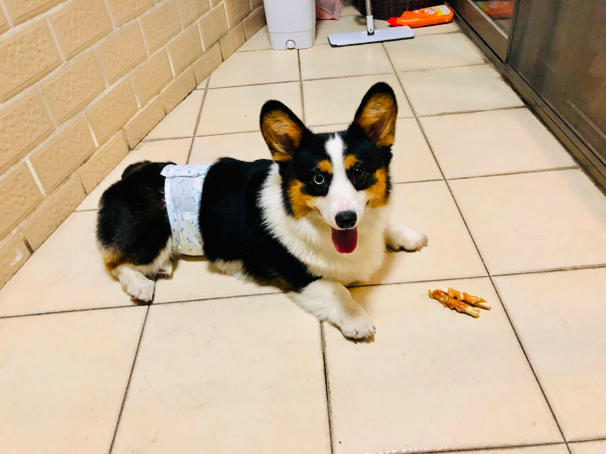

## 👋 Introduction

<!--
**erkang/erkang** is a ✨ _special_ ✨ repository because its `README.md` (this file) appears on your GitHub profile.
-->
### Hi there 👋

I'm `erkang`. 你也可以在我的 [blog](https://qekang.com) 找到我。

我是一名喜欢折腾新技术，也喜欢把想法做成产品的开发者。过去十余年，主要与 Java 和企业级系统打交道，接触和参与过 **MES、ERP、SCM、WMS、PLM、QMS** 等制造业与企业管理系统，也涉足过金融、健身等领域的项目。如今，我把更多精力投入到 **AI Engineering、智能体系统，以及 AI 在真实业务中的落地**。

我的实践不只在研发这一侧。我做过独立站和外贸获客产品，也亲自承担过从产品经理到开发的不同角色：梳理需求、设计流程、搭建产品，再到营销推广和运营反馈。除了功能如何实现，我同样关心产品为什么有人需要、如何被发现，以及用户为什么愿意留下来。

围绕这些问题，我也折腾过 **TikTok、LinkedIn、抖音、Facebook、X** 等平台的账号与内容运营，尝试过创意项目、视频和漫剧制作。这些经历让我更直观地理解：**把产品做出来只是开始，让它被理解、被使用，并持续产生价值，才是完整的交付。**

在工程实践中，我做过 **Skills 开发、工作流设计与编排、RPA 自动化**，也搭建过多模型、多 Agent 的协作链路。我喜欢把反复出现的任务拆解清楚，将经验沉淀为可复用的 Skills，将步骤组织成可执行的工作流，再通过 RPA 和工具调用连接具体的软件操作，让方案不只停留在文档里，而是真正跑起来。

这些实践也让我越来越重视不同技术之间的配合：模型负责理解与生成，工作流组织执行步骤，RPA 衔接界面操作，确定性程序处理明确规则，人则保留关键判断。相比让一个 Agent 包办所有事情，我更关心如何设计合理的分工、异常处理与验收机制。

我持续实践 Claude、Codex、Gemini、DeepSeek、GLM、Qwen、MiniMax 等模型与开发工具，也关注 **Agentic Coding、MCP、Context Engineering 和 Harness Engineering** 等方向。兴趣还延伸到知识库与长期记忆、多模态理解、浏览器与桌面自动化，以及图像、视频和内容生成工作流。遇到有意思的新技术或开源项目，我通常会自己搭起来，放进实际场景里试一试，看看它能解决什么问题，又会在哪里遇到限制。

不过，喜欢新技术，不等于每个问题都要用最新的方案。不同领域的经历，逐渐形成了我的工作习惯：**先理解全局，再深入局部；先判断问题，再选择技术。** 我习惯把业务目标、用户体验、系统架构、团队协作和投入成本放在一起考虑，而不是只关注某个功能是否完成。

我尤其喜欢寻找那些影响全局的“关键裂缝”：需求与真实问题之间的偏差、系统衔接中的断点、团队协作中模糊的责任，以及产品能力与市场表达之间的错位。有时候，推动项目向前的关键，不是继续增加功能，而是找到并补上那个被忽略的环节。

我也重视团队协作。复杂项目需要的不只是任务分配，还包括目标对齐、上下文共享、清晰的责任边界和及时反馈。无论是人与人，还是人与 Agent 协作，我都希望局部工作的完成，最终能够汇成整体结果。这也是我认同 **FDE 式工作方式**的原因：走近业务现场，让需求、实现和反馈保持连接，而不只停留在方案或演示里。

对我来说，产品、研发、自动化、营销和内容，是同一个问题的不同侧面：**如何把一个值得做的想法，变成真正有人使用的东西。** 我享受从零探索，也愿意把实践沉淀为工具、Skills 和工程方法，让一次性的尝试逐渐成为可复用、可验证、可持续改进的能力。

工作之外，我喜欢音乐、电影、健身，也喜欢德州扑克这类需要策略、概率判断和耐心的游戏。享受推演与博弈，也提醒自己：好的决策不一定每次都赢，一次结果也不能说明全部。


 **我现在主要把时间花在:**

<!--START_SECTION:waka-->

```txt
From: 2026

Average Daily Time: 11 hrs 08 mins

AI Engineering    8 hrs 42 mins  ███████████████████▓░░░░░   78.14 %
Linux             1 hrs 24 mins  ████████████▒░░░░░░░░░░░░   12.57 %
Markdown          32 mins        ████▓░░░░░░░░░░░░░░░░░░░░   04.79 %
YAML              18 mins        ██▓░░░░░░░░░░░░░░░░░░░░░░   02.69 %
HTML              12 mins        █▓░░░░░░░░░░░░░░░░░░░░░░░   01.80 %
```


### 🌐 Find Me


<p>
  <a href="https://qekang.com" target="_blank"></a>
  <a href="https://blog.csdn.net/qierkang" target="_blank"></a>
  <a href="https://gitee.com/qierkang" target="_blank"></a>
  <a href="mailto:xyqierkang@163.com" target="_blank"></a>
  
</p>

-----
<table>
  <tbody>
  <tr>
    <td><a href="./assets/shutiao.png" target="_blank"></a>
    </td>
  </tr>
  <tr>
    <td>
      <a href="https://jrebel.qekang.com" target="_blank"></a>
     <a href="https://jrebel.qekang.com" target="_blank"></a>
    </td>
  </tr>
  </tbody>
</table>
